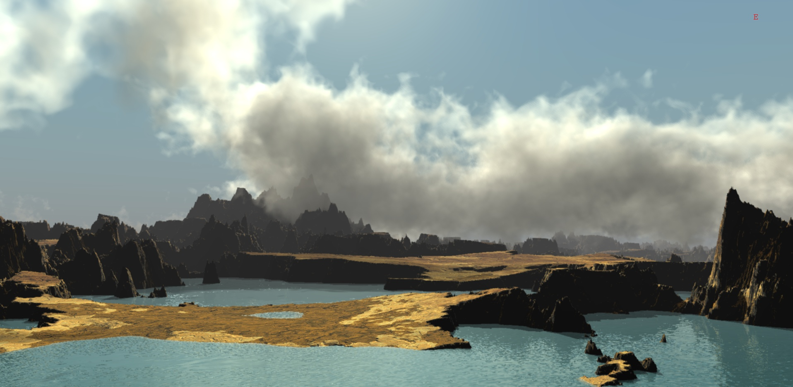
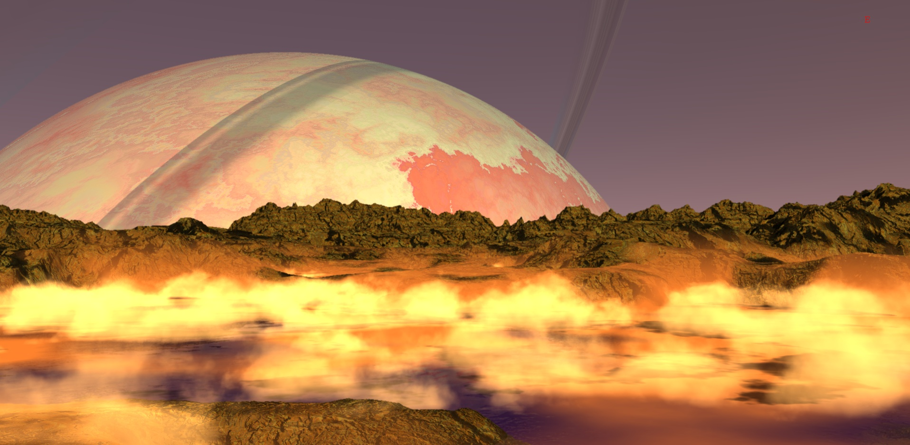
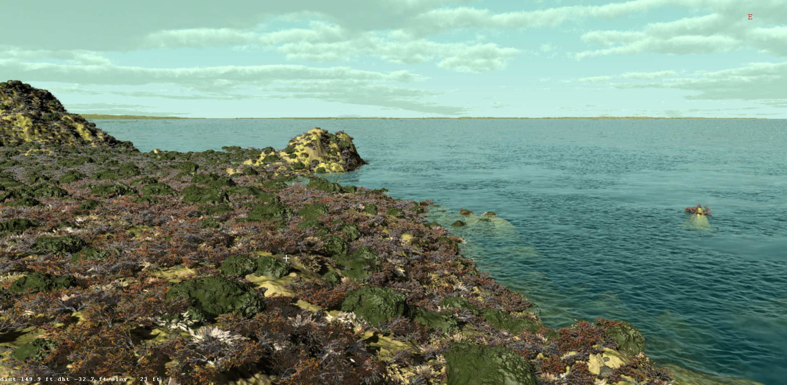
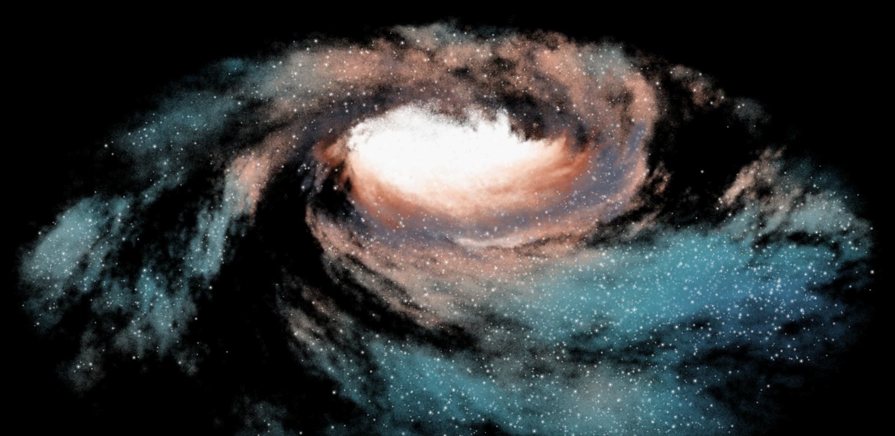
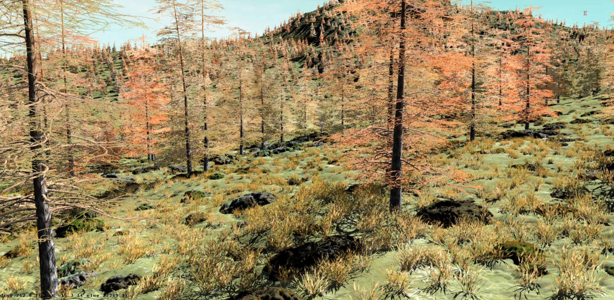
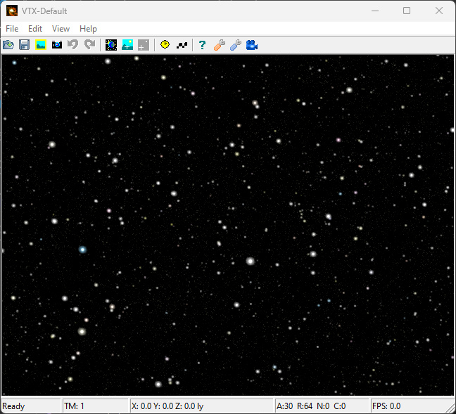
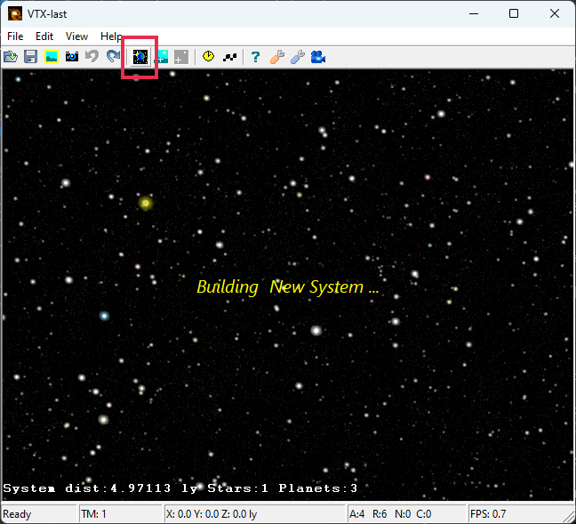
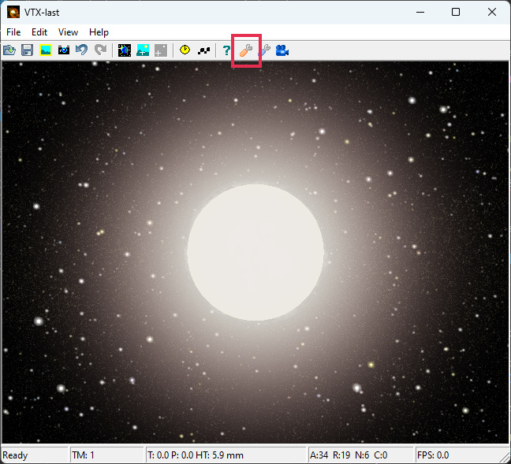
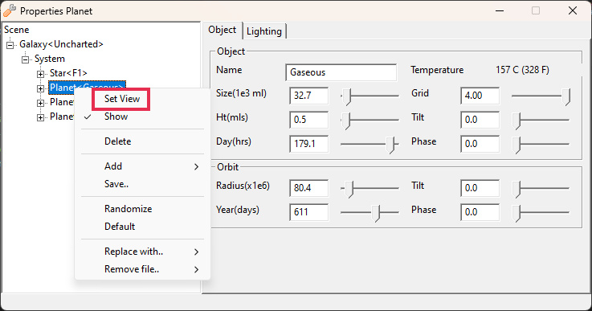
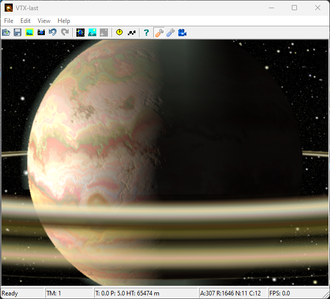

# VTX

**Virtual Terrain Explorer: a procedural universe generator and renderer.**

VTX generates a universe of galaxies, star systems, planets and moons, then lets you fly from deep space down to a planet's surface. Scenes are built almost entirely from procedural techniques, so detail keeps increasing as you get closer.



| | |
|:---:|:---:|
|  |  |
|  |  |

More screenshots are in the [Images](Images) directory.

## Features

- **Objects:** galaxies, stars, planets, moons, rings and asteroids
- **Terrain:** multiple layers, craters, erosion, oceans and snow
- **Surface detail:** 3D rocks, plants and sprites
- **Atmosphere:** sky, haze, fog, and 2D, 3D and ray-marched volumetric clouds
- **Lighting:** shadows, eclipses, water reflections and HDR
- **Scene editing:** a graphical editor, or a text-based scene language you can edit by hand

VTX is written in C++ using OpenGL and GLSL for graphics and wxWidgets for the UI.

## Getting started

### Requirements

- Memory: 8 GB or more
- Graphics: NVIDIA GTX 980 or better (Intel integrated graphics will not work)
- Operating system: tested on Windows 10 and 11, and Ubuntu 18.04
- [Git Bash](https://git-scm.com/downloads) on Windows

### Run VTX

**Windows:** download the latest release from the [Releases page](https://github.com/dwsindorf/VTX/releases):

- **VTX-win64-*version*-setup.exe** installs VTX for the current user (no administrator rights needed) and adds it to the Start menu.
- **VTX-win64-*version*.zip** is the same program without an installer. Unzip it into a folder you can write to (not *C:\Program Files*) and run **VTX.bat**.

**Linux:** run the Linux build from a clone of this repository:

```sh
git clone https://github.com/dwsindorf/VTX
cd VTX/bin
./vtx-last     # reopens your last session, if there is one
```

The [User Manual](Docs/VTX-User-Manual.odt) explains how to use VTX, and the [Theory of Operation](Docs/VTX-Theory-of-Operation.odt) explains how it works. Both are included as PDFs in the Windows download.

You should see the startup window:



### Visit a new star system

1. Select a star in the star field and press **Go to Orbit** in the toolbar.

   

2. Open the Scene Tree dialog.

   

3. Select an object in the system to view it.

   

4. View or edit the selected object.

   

You can repeat this from any star in the new system.

## Building from source

VTX is built on Windows with Cygwin, its MinGW-w64 cross-compiler and a static build of wxWidgets. [BUILDING.md](BUILDING.md) has the full instructions, including how to package a release.
